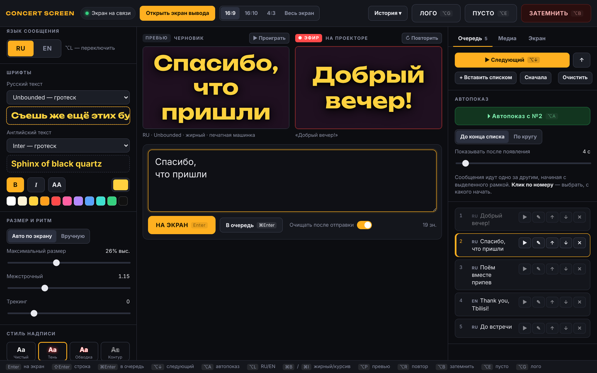
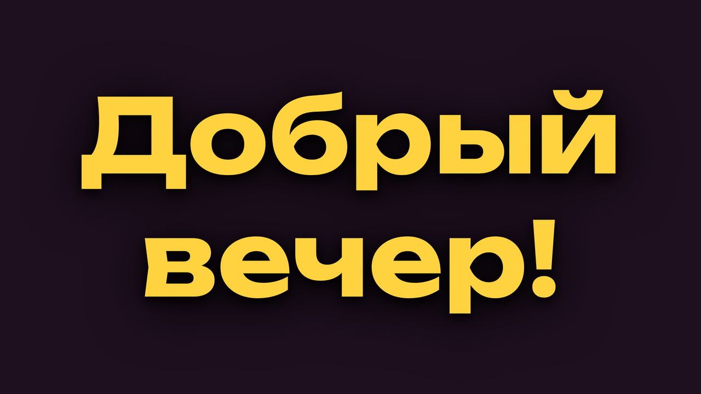

# Concert Screen

Пульт для вывода текста на проектор во время концерта. Пишешь на ноутбуке — текст печатается на экране за спиной музыкантов, с анимацией и мигающим курсором.

Два окна Chrome: **пульт** (`control.html`) на экране ноутбука и **экран вывода** (`output.html`) на проекторе. Работает локально, без интернета, без сервера и без установки.

*A two-window Chrome setup for live concert visuals: type on the laptop, the text types itself out on the projector. Russian UI, no build step, no server, works offline.*

## Возможности

- Живой ввод: **Enter** — на экран, **Shift+Enter** — перенос строки
- Анимация появления: печатная машинка с курсором, побуквенное проявление, выезд, размытие, мерцание; скорость регулируется
- Отдельные шрифты для русского и английского текста: 27 локальных шрифтов, 19 с кириллицей
- Жирный, курсив, заглавные, цвет; стили надписи: тень, обводка, контур, плашка, неон, свечение, ретро
- Автоподгонка размера текста под экран или ручной размер
- Превью черновика и монитор эфира рядом
- Очередь заготовок: вставка списком, правка, перестановка, автопоказ до конца или по кругу с любого сообщения
- Картинки и видео: вывод вместо текста, фоном или как логотип
- Кнопки ЗАТЕМНИТЬ, ПУСТО, ЛОГО и горячие клавиши
- История эфира с повторной отправкой
- Калибровка под проектор: формат 16:9 / 16:10 / 4:3, сетка, поля, сдвиг, масштаб, зеркало для проекции сзади
- Восстановление после перезагрузки любого из окон

## Запуск

1. Скачай репозиторий: **Code → Download ZIP** и распакуй.
2. В macOS: Системные настройки → Мониторы → проектор в режиме **расширенного рабочего стола** (не дублирования).
3. Открой `control.html` в Chrome (перетащи файл в окно Chrome).
4. Нажми **«Открыть экран вывода»**.
   - При первом запуске Chrome может спросить разрешение на всплывающее окно и на «Управление окнами». Разреши: тогда окно само встанет на проектор.
   - Если не встало, перетащи окно на проектор вручную.
5. В окне вывода нажми **F** или сделай двойной клик — полный экран. Курсор на проекторе прячется сам.
6. Индикатор «Экран на связи» в шапке пульта должен гореть зелёным.

Перед концертом в Терминале можно запустить `caffeinate -d`, чтобы Mac гарантированно не гасил экран.

Проверено в Chrome на macOS. В других браузерах на базе Chromium должно работать так же.

## Как пользоваться

- Слева «Превью» (черновик, кнопка ▶ проигрывает анимацию), справа «Эфир» (то, что сейчас на проекторе).
- На экране всегда что-то одно: сообщение, картинка, лого, пустой фон или затемнение. Каждое новое заменяет предыдущее.
- **ЗАТЕМНИТЬ** (⌥B) делает экран полностью чёрным; повторное нажатие («ВЕРНУТЬ») возвращает то, что было.
- **ПУСТО** (⌥E) оставляет только фон. **ЛОГО** (⌥G) выводит логотип, повторное нажатие убирает его.
- **История ▾** в шапке: всё, что выходило в эфир. ↻ отправляет снова, ✎ возвращает текст со стилем в редактор.
- **Применить стиль к тексту в эфире** меняет оформление текущего текста без повторной анимации.

### Горячие клавиши
| Клавиша | Действие |
|---|---|
| Enter / Shift+Enter / ⌘Enter | на экран / новая строка / в очередь |
| ⌥↓ / ⌥↑ | следующее сообщение из очереди / шаг назад |
| ⌥A | запустить / остановить автопоказ |
| ⌥L | переключить язык RU/EN |
| ⌘B / ⌘I | жирный / курсив |
| ⌥P | проиграть превью |
| ⌥R | повторить анимацию текущего эфира |
| ⌥B / ⌥E / ⌥G | затемнить / пусто / лого |

### Очередь
«Вставить списком»: сообщения разделяются пустой строкой, язык каждого определяется автоматически. Клик по сообщению (или ✎) открывает его на правку: текст и переносы меняются в поле ввода, превью показывает результат. **Enter** сохраняет изменения обратно в очередь (на экран ничего не уходит), **Esc** отменяет правку. ▶ сразу отправляет сообщение на экран.

### Автопоказ
Блок «Автопоказ» во вкладке «Очередь» выводит заготовки одну за другой без нажатий.
- **С какого начать:** клик по **номеру** сообщения ставит на него рамку, автопоказ стартует с него.
- **До конца списка** или **По кругу** (после последнего снова идёт первое).
- **Показывать после появления:** сколько секунд текст стоит на экране после того, как допечатался.
- Запуск и остановка: кнопка или **⌥A**. Любой ручной вывод (Enter, ЛОГО, ПУСТО, ЗАТЕМНИТЬ, «Следующий») автопоказ останавливает.

### Медиа
Картинки и видео перетаскиваются прямо в окно пульта. У каждого файла три кнопки-переключателя:
- **Эфир** (красная) — показать вместо текста; повторное нажатие убирает с экрана.
- **Фон** (синяя) — поставить фоном; повторное нажатие снимает фон.
- **Лого** (жёлтая) — назначить логотипом для кнопки ЛОГО; повторное нажатие снимает назначение.

Форматы: PNG, JPG, WebP, GIF; видео — MP4 (H.264) или WebM. TIFF и HEIC Chrome не показывает, их нужно предварительно сохранить в PNG или JPG. Файлы хранятся в браузере и переживают перезагрузку.

### Вкладка «Экран»: калибровка на площадке
1. Включи «Показать сетку», выбери формат кадра в шапке (16:9 / 16:10 / 4:3 / Весь экран), подбери тот, где зелёная рамка совпадает с краями проекции.
2. Если музыканты загораживают низ, сдвинь кадр вверх («Сдвиг по вертикали») или уменьши «Масштаб кадра».
3. Если проектор светит на ткань сзади, включи «Отразить по горизонтали».
4. Цвет фона подбери под площадку: проектор не умеет настоящий чёрный, поэтому по умолчанию стоит тёмно-синий. Там же «Затемнение медиа-фона» и кнопка «Убрать» для медиа-фона.

## Если что-то пошло не так
- **Перезагрузили окно вывода:** оно само восстановит последнее состояние.
- **Перезагрузили пульт:** связь восстановится сама через пару секунд.
- **Закрыли окно вывода:** снова нажми «Открыть экран вывода».
- **Индикатор не зелёный:** нажми «Открыть экран вывода» ещё раз.

## Как это устроено
- `control.html`, `assets/control.js` — пульт
- `output.html` — экран вывода
- `assets/shared.js`, `assets/stage.css` — общий рендер сцены: текст, анимации, фон, калибровка. Один и тот же код рисует проектор и мониторы на пульте, поэтому превью совпадает с выводом.
- `fonts/` — локальные шрифты (woff2) и их лицензии

Пульт и экран общаются через `postMessage`, а `localStorage` служит запасным каналом и хранит состояние для восстановления после перезагрузки. Медиафайлы лежат в IndexedDB. Сборки и зависимостей нет: чистые HTML, CSS и JavaScript.

## Идеи
- Реакция визуала на звук с микрофона ноутбука (пульсация текста или фона).

## Лицензия
Код — [MIT](LICENSE). Шрифты в эту лицензию не входят: они распространяются под лицензиями своих авторов — [SIL Open Font License 1.1](https://openfontlicense.org), шрифт Permanent Marker — Apache 2.0. Тексты лицензий лежат в [`fonts/licenses`](fonts/licenses).
